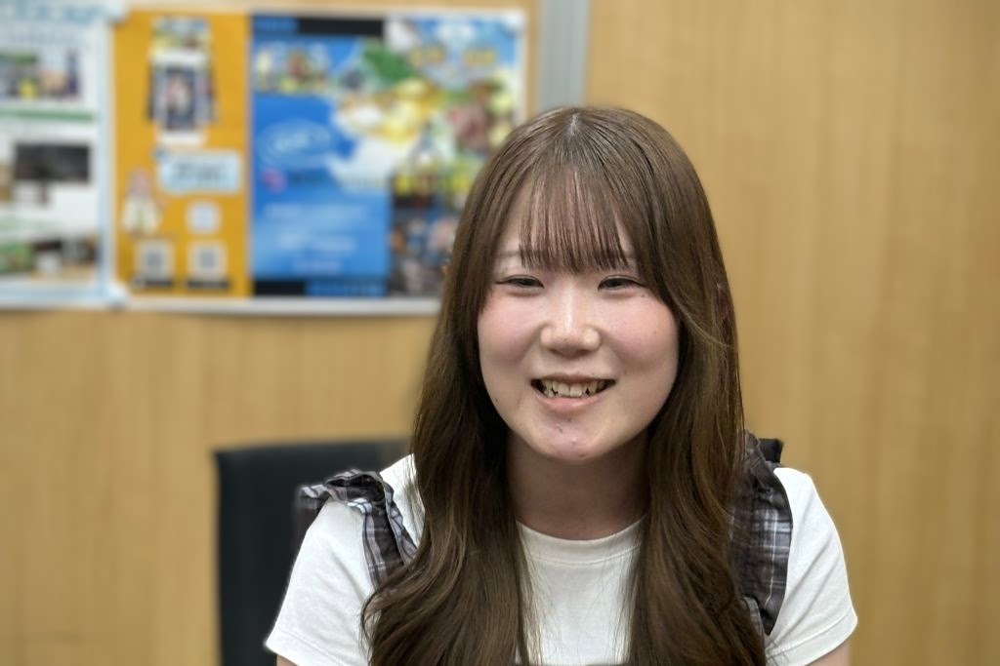
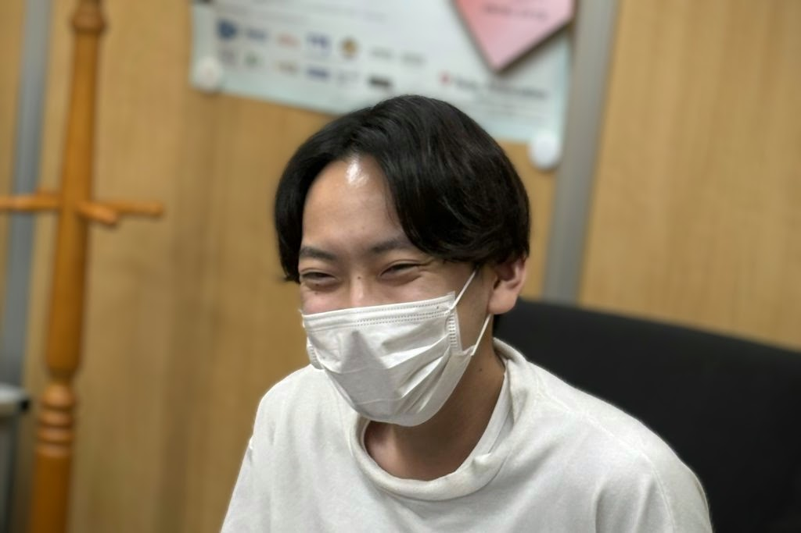
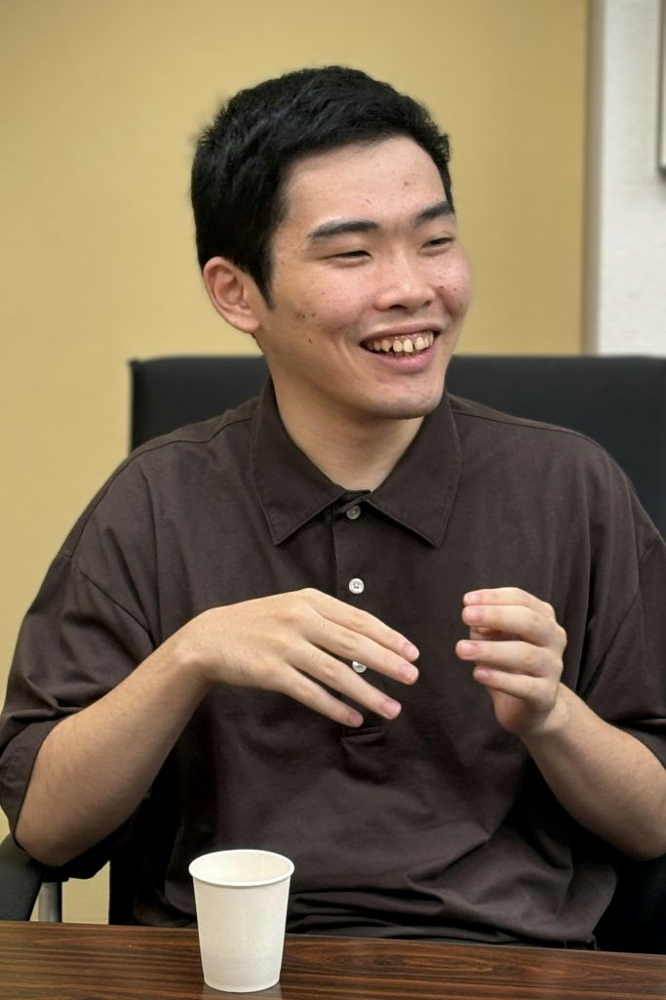
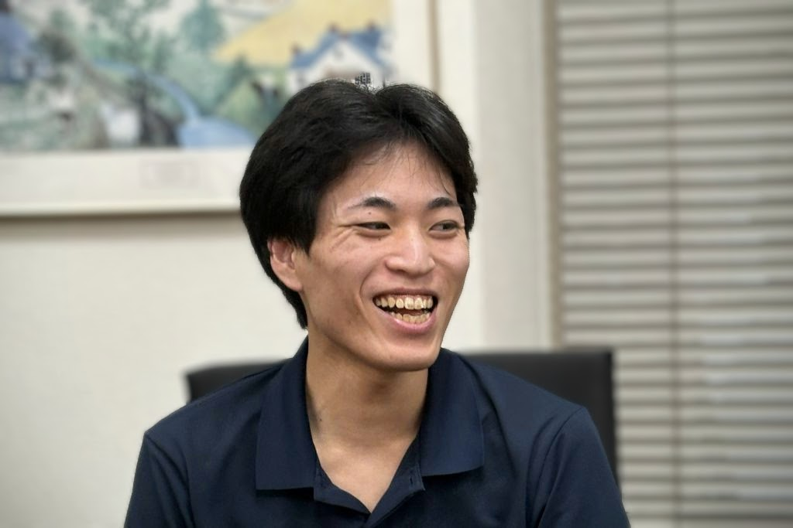
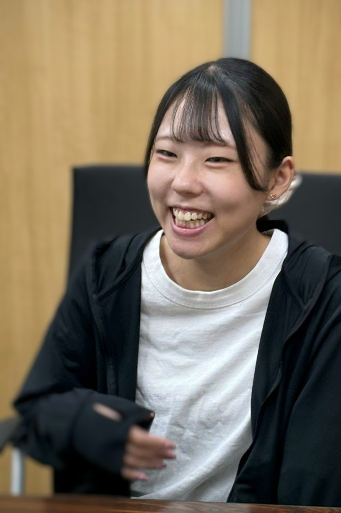
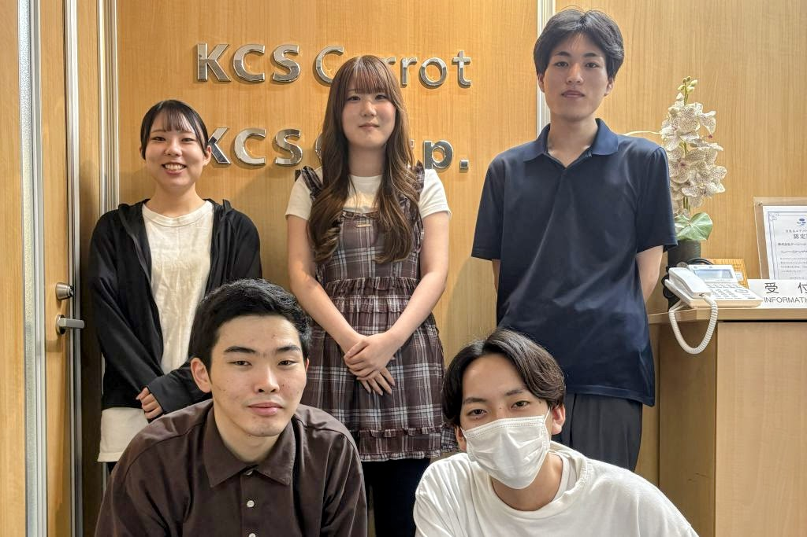

こんにちは、ブログ運営チームです。
今年も、恒例となりました新卒メンバーへのインタビューを実施しました。

社会人・ソフトウェア技術者としての第一歩を踏み出した新人さんたちの人となりや、業務に取り組む様子をご想像いただけたら嬉しいです。

## 目次

* [参加メンバー](#参加メンバー)
* インタビュー本編
  * [Q: 入社前に一番不安だったこと・入社してみてそれがどう変わったか](#q-入社前に一番不安だったこと入社してみてそれがどう変わったか)
  * [Q: 研修中や業務の中で、先輩社員や研修担当に助けてもらったこと](#q-研修中や業務の中で先輩社員や研修担当に助けてもらったこと)
  * [Q: 研修や業務の中で、「自分でもできた！」と感じた瞬間](#q-研修や業務の中で自分でもできたと感じた瞬間)
  * [Q: 今後チャレンジしてみたいこと](#q-今後チャレンジしてみたいこと)
  * [Q: 今の自分から、入社前の自分へ一言メッセージを贈るとしたら](#q-今の自分から入社前の自分へ一言メッセージを贈るとしたら)
  * [Q: 来年入社する未経験の方へ伝えたいことはありますか？](#q-来年入社する未経験の方へ伝えたいことはありますか)

## 参加メンバー

### 野口

* システム開発第一グループ所属
* 好きなドーナッツはポン・デ・リング
* セルフネイルを時間が空いたときにやっている
* 同期からの印象 
  「堂々としている人だなと感じる、物怖じしない」(山口) 
  「専門学校での経験者なだけあって、プログラミングに詳しい」(八須)

### 八須

* システム開発第一グループ所属
* 好きなドーナッツはポン・デ・リング
* 特撮が好き
* 最近はよく友達と映画を観に行っている
* 同期からの印象 
  「語彙力高めで面白い人(野口)」 
  「素直な人」(山口)

### 山口

* システム開発第一グループ所属
* 好きなドーナッツはフレンチクルーラーやエンゼルフレンチ
* 社会人になってから身体がなまっているのでランニングをよくしている
* 同期からの印象 
  「何でも率先してやり、まとめてくれる。笑ってくれるので発言しやすい」(伊藤) 
  「プログラミングができて身体動かすのが好きな人」(森)

### 森

* システム開発第二グループ所属
* 好きなドーナッツはポン・デ・リング
* 健康を意識して野菜を食べている
* 最近はよく二次元系アイドルのライブに行っている
* 同期からの印象 
  「すごく努力している人、研修でタイピングのやり方を変えて速くなっていたのがすごい」(伊藤) 
  「自分が世界史が好きなので、用語が通じて楽しい」(八須)

### 伊藤

* H2開発グループ所属
* 好きなドーナッツはポン・デ・リング
* 趣味はゲーム、ゲーム配信を観ること、ネイルをすること
* 最近ハマっているのは筋トレ、10分くらいの動画を見てやっている
* 同期からの印象 
  「タイピングがすごく速い」(森) 
  「マメな人、プログラミングのレビューでもミスが少なかった」(山口)

聞き手: ブログ運営チーム

## Q: 入社前に一番不安だったこと・入社してみてそれがどう変わったか

{:.talk-paragraph}
* **――**{:.interviewer}
    * 入社前一番不安だったことと、入社してみてその不安がどのように解消されたか・変わったかを教えてください。
* **野口**{:.speaker}
    * プログラミングは元々やっていたのであまり心配してなくて、どちらかと言うと人間関係をとても心配していました。会社に馴染めるか、同期とうまくやれるか、考えていました。実際に入社してみて、割とうまくやっていけているので良かったです。
* **森**{:.speaker}
    * 自分が入社前に不安だったのはやはり生活リズムですね。大学生活も後半になるとほとんど単位も取り終わって時間が増えたので、不規則な生活をするようになってしまいました。それを社会人になってから調整できるのかなと不安でした。
    * 実際に社会人になってみたら、無理なく生活リズムを戻せたので、良かったです。
* **山口**{:.speaker}
    * 自分も生活習慣ですね。夜勤のアルバイトだったので、働き始めて生活習慣を直せるかが心配でしたが、気合いで頑張りました。
* **伊藤**{:.speaker}
    * プログラミング未経験なので、できるかどうかが一番不安でした。でも研修がとてもしっかりしていたので、一通りできるようになった気がしています。
* **八須**{:.speaker}
    * 自分はアルバイトをした経験がなく、働くことが初めてでした。さらに経験のないプログラミングもできなかったらと不安に思っていました。伊藤さんも言っていた通り、研修を通してプログラミングが一通り出来るようになって良かったと思います。安心しています。

## Q: 研修中や業務の中で、先輩社員や研修担当に助けてもらったこと

{:.talk-paragraph}
* **――**{:.interviewer}
    * 研修中や業務の中で、先輩社員や研修担当に助けてもらったエピソードを教えてください。
* **山口**{:.speaker}
    * C#でアプリケーションを作っていて、業務内で学んだことをチーム内で週に1回発表する機会があるのですが、質問が来て回答に苦労していると、毎回上司が助けてくれるので助かってます。
* **伊藤**{:.speaker}
    * 研修中は研修担当の方が付きっきりで見てくれていました。開発課題では毎日30分から1時間くらい相談の時間をとってもらえていたので安心でした。配属されてからもすぐ隣に先輩社員が居るので、何かあったらすぐに聞ける環境はとても安心するし、ありがたいなと思います。
    * 研修で初めてプログラミングを習ったときは配列の意味がわからなくて、何度も質問していました。
* **――**{:.interviewer}
    * 私も初めの頃、配列はよく分からなかったです(笑)
* **野口**{:.speaker}
    * 研修中は私も何度も質問していました。配属されてからも一緒ですね。今は担当システムのコードを触ったり、実務の一部をやらせてもらっています。分からないところは都度質問していますが、毎回丁寧に答えていただいて本当にありがたいです。
* **八須**{:.speaker}
    * 自分はたくさん質問するタイプなので、研修中にたくさん質問をして、全部答えていただいたのが一番助けになりました。
    * 配属後の業務では、コードレビューでレビュアーに指摘を受けて自分なりの意図を説明したあと、さらに指摘の背景を説明してもらえるので、ありがたいなと思っています。自分だけでは考えつかない発想もあるんだなと感じます。
* **――**{:.interviewer}
    * レビューの時に自分の意見を言えるのは、考えながらやっている証拠なのでいいことだと思います。
* **森**{:.speaker}
    * 入社して3ヶ月間の研修は、自分も研修担当の方に頼りきりでした。研修担当の方から私物のC++の参考書を借していただいて、より理解が深まったと感じています。
    * 今は業務に向けた研修をやっています。基本的にAIに聞きながら進めていますが、どうしても分からないところはSlackで相談しています。すぐ対応してくれるので安心して相談できます。

## Q: 研修や業務の中で、「自分でもできた！」と感じた瞬間

{:.talk-paragraph}
* **――**{:.interviewer}
    * 研修や業務の中で、「自分でもできた！」と感じる瞬間を教えてください。
* **山口**{:.speaker}
    * 初めて触った言語で初めての作業をするとき、色々試行錯誤の末に動作しているのを見ると達成感があります。デバッグして、ブレークポイントを置いて、上司に相談して(笑)。
* **伊藤**{:.speaker}
    * 最初はエラーがたくさん出て、都度質問したりエラーメッセージを翻訳にかけたりしていました。最近は同じエラー、例えばスペルミスとかが出たら何となく理解ができるようになってきて成長したと思いますね。
* **八須**{:.speaker}
    * はじめの頃は作業の全体像が理解しきれず、行き詰まると教えてもらった通りの操作をするだけでした。そのうち同じ原因で行き詰まったことに自力で気付いて解決出来るようになりました。最終的になぜその操作で問題が解決するかが理解できるようになり、自分でも「ちゃんと出来るようになったかな」と思います。
* **野口**{:.speaker}
    * OJTの最初の頃は手探りでコードを書いていたのですが、そのあとに実際に動いているアプリケーションを触ったとき、コードに書いてあることの意味を理解して納得できました。
* **森**{:.speaker}
    * OJTでは、研修で学ぶC++とはまた全然違う言語を使っています。最初はコードの意味が分からなかったのですが、AIを活用することで少しずつ分かるようになりました。

## Q: 今後チャレンジしてみたいこと

{:.talk-paragraph}
* **――**{:.interviewer}
    * 今後チャレンジしてみたいことを教えてください。
* **八須**{:.speaker}
    * いま多言語対応が必要な検索システムの開発を担当しています。自分が辞書を引いたり、インターネットで調べものをするのが好きなこともあり、多言語の検索に関わるコードに面白さを感じているのでそのようなシステムの開発に関わっていきたいなと思っています。
* **山口**{:.speaker}
    * そろそろOJTも終わって、本格的に業務をやっていくことになるので、ITパスポートくらいは取ろうかなと思っています。
* **野口**{:.speaker}
    * 私も一緒で、入社したときから資格を取りたいなと思っていました。私は基本情報を目指します。
* **森**{:.speaker}
    * 自分は今OJTでWebシステムを作っているので、そこを極めていきたいなというのがあります。あとは所属しているシステム開発第二グループはインフラ技術にも力を入れているので、そちらも興味があります。一人前になった頃にチャレンジしてみたいです。サーバーのキッティングとか楽しそうだなと。
* **伊藤**{:.speaker}
    * 研修中にやったCSSが楽しかったので、チャレンジしてみたいです。今ちょうどやり出したJavaScriptも楽しそうなので興味があります。あとは私もITパスポートを取りたいなと思っています。
* **――**{:.interviewer}
    * いいですね！みなさん頑張ってください。

## Q: 今の自分から、入社前の自分へ一言メッセージを贈るとしたら

{:.talk-paragraph}
* **――**{:.interviewer}
    * 今の自分から入社前の自分へ、一言メッセージを贈るとしたら、何と伝えますか？
* **伊藤**{:.speaker}
    * 入社前はとても不安だった気がするんですけど、入社してみたらみんな優しいし、プログラミングもなんとかなるので、安心してほしいです。
* **森**{:.speaker}
    * もっと肩の力を抜いて、気楽に社会人生活をはじめて大丈夫だよ、って伝えると思います。学生時代はもっと厳しく指導されるイメージを持っていました。実際入ってみると想像していたほどではなくて安心しました。
* **八須**{:.speaker}
    * アルバイトの経験がないこともあり、初めは働くことに対する体力的な心配がありました。今はテレワークなので、業務が終わった後でも生活できるくらいの体力は残っているから、そこまでの心配はいらないということを伝えたいです。
* **野口**{:.speaker}
    * そのままで大丈夫だよ、ってぐらいです。思ってたよりは全然楽しいです。
* **山口**{:.speaker}
    * 「コーヒーを常備しろ」と、「座席を決める時は、冷房の当たる席を希望しろ」。
    * 自分が座っている席は、冷房が効きにくくて暑かったのですが、自分が快適に過ごせる温度にすると冷房があたる席のみんなは寒く感じるようで、設定温度を上げていたんですよね。ただそれだと自分はちょっと暑いなと感じていたので。コーヒーは必要ないと思っていましたが、意外と飲むなぁって研修が終わったあとに気付きました。今は毎日飲んでいます。

## Q: 来年入社する未経験の方へ伝えたいことはありますか？

{:.talk-paragraph}
* **――**{:.interviewer}
    * 最後の質問になります。来年入社する未経験の方へ伝えたいことを一つ教えてください。
* **伊藤**{:.speaker}
    * さっきと被っちゃうんですけど、みんな優しいので安心して欲しいです。心配せずに学生生活を楽しんでほしいです。
* **野口**{:.speaker}
    * 一緒です(笑)。そんな身構えないで、気楽に過ごしてほしい。
* **八須**{:.speaker}
    * 文系出身なので難しいかなと思っていましたが、それでもプログラミングが出来るようになったので安心してくださいって思っています。
* **山口**{:.speaker}
    * 質問したらちゃんと答えてくれる人しかいないので、分からないときはすぐ聞いてほしいです。
* **森**{:.speaker}
    * 自分でも何とか社会人としてやっていけているので、そんなに恐れなくても大丈夫。社会人になるとさすがに学生時代ほど簡単にまとまった自由時間を取れないので、今を楽しんで欲しいなと思います。

